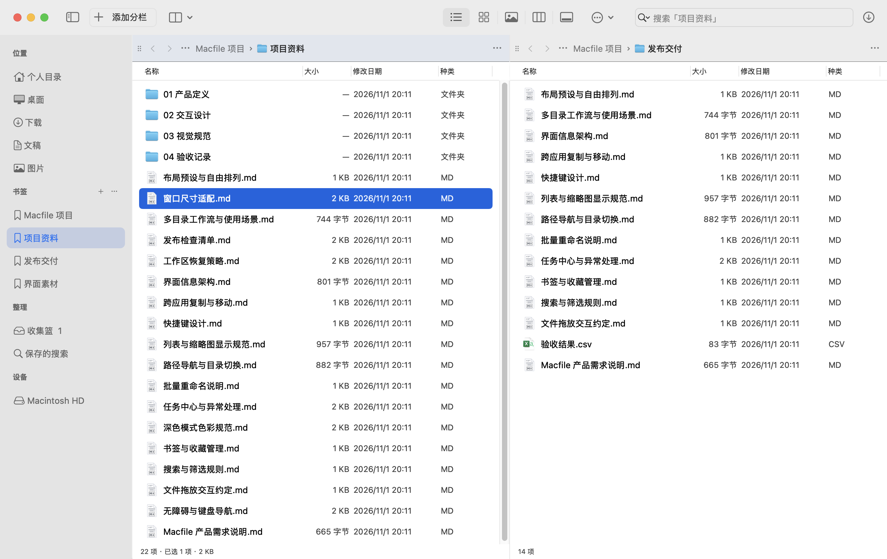

# Macfile

原生 macOS 多目录文件工作台。一个主窗口中可持续添加目录窗口，独立使用标签、列表、图标、缩略图、分栏与画廊。Swift + AppKit 实现，无第三方运行依赖。当前版本：1.0.3。



[下载最新版本](https://github.com/ZWLFI/Macfile/releases/latest) · [验证记录](VALIDATION.md)

## 界面设计

文件内容是界面的主体。顶部只有一条原生工具栏，平铺／分割模式中的目录区域连续铺满，使用细分隔线区分；不再显示重复的应用／工作区标题，也不在内容区内嵌套圆角窗口卡片。自由摆放模式保留必要的窗口边界。

工具栏中的搜索、显示模式和文件操作跟随当前分栏，当前分栏使用轻微的系统强调色背景；其他分栏保留自己的搜索和视图。目录头部只放导航，宽窗口显示当前目录及上一级，窄窗口优先显示当前目录。完整路径可通过路径左侧省略号菜单访问，或按 ⌘L 直接编辑。

侧栏使用系统材质、整行悬停和圆角选中状态；列表采用原生内缩选中样式与清晰的字号。文件名占用剩余宽度，窄分栏自动隐藏种类和日期列。单标签时隐藏标签栏，多标签时显示独立关闭按钮，并自动滚动到当前标签。操作反馈短暂显示，任务详情从右上角进入。

标签在本次运行中各自保留前后导航、搜索词和递归范围；再次点击当前标签不重置状态。切换目录立即清除旧内容，读取中显示进度，读取失败与空文件夹分开呈现。同目录刷新保留仍然有效的选择。

右键空白区显示目录操作，右键文件显示与当前选择匹配的操作；不能执行的菜单动作会禁用。Control-Tab / Control-Shift-Tab 切换标签，路径与搜索框仍保留标准文本编辑快捷键。

画廊优先选择图片，文件夹显示图标与打开提示。管理窗口支持筛选后保留选择、键盘确认和空结果提示；任务中心默认展示最近任务及文件明细，暂停、取消和撤销按钮随任务状态变化。

搜索时在目录标题下显示“当前目录／包含子目录”切换，可一键清除；Return 将焦点移回文件区，Escape 清除搜索并返回文件区。空目录可直接新建文件夹，无结果可清除搜索，读取失败提供中文说明、重试和返回上一级；这些状态同样适用于画廊。切换显示模式、标签和路径后，键盘焦点跟随当前文件视图。

图标和缩略图文件名支持双行显示，选中背景跟随深浅主题变化；双击空白不会打开残留选择。管理器中需要单项的动作仅在单选时可用，批量操作保留多选。工具窗口在前台时，⌘W 关闭该窗口，文件快捷键不会误操作后台目录。书签编辑按项目身份确认，重命名规则无效时立即清空失效预览。

## 运行与安装

从 Releases 下载 `Macfile-1.0.3-macOS-arm64.zip`，解压后将 `Macfile.app` 放入 `~/Applications`（或 `/Applications`）并打开。当前安装包适用于 Apple Silicon；Intel 用户需要自行构建，尚未完成 Intel 运行回归。应用仅作本地签名，未经过 Apple 公证，其他 Mac 可能提示无法验证开发者。

也可以从源码构建：

应用包：`artifacts/Macfile.app`。本机安装路径默认是 `~/Applications/Macfile.app`。

```bash
# 构建 Release 应用包、生成图标并作本地签名
./scripts/build.sh release

# 安装到当前用户的 Applications，并启动
# 若同名应用已存在，脚本先保留带时间戳的备份
./scripts/install.sh
```

需要 macOS 和 Swift 5.9 以上的 Command Line Tools。当前交付构建在 Apple Silicon、macOS 27.0.1、Swift 6.1.2 上验证；项目部署目标为 macOS 13，但旧系统与 Intel 硬件尚未做运行回归。

应用使用 ad-hoc 本地签名，可用于当前 Mac。本次未配置 Developer ID 证书、Apple 公证或 App Store 发布；复制给其他 Mac 时，系统可能要求额外的来源验证。程序不更改 Finder 默认关联，也不安装后台特权服务。

## 已实现的 1.0 功能

| 范围 | 功能 |
| --- | --- |
| 多目录 | 持续添加目录窗口、独立标签、独立主窗口、关闭恢复、窗口总览、临时放大 |
| 布局 | 自动平铺、递归水平／垂直分割、拖动标题栏换位或分割、自由摆放与缩放、锁定布局 |
| 布局库 | 205 个去重预设、按窗口数量筛选、收藏、布局撤销；切换时保留已打开目录 |
| 恢复 | 自动保存主窗口会话、目录、标签、视图、布局；命名工作区及管理 |
| 文件视图 | 列表、图标、缩略图、分栏、画廊、Quick Look、检查器、隐藏文件、列表排序 |
| 拖放 | 目录之间、主窗口之间、Finder 与支持标准文件拖放的外部应用；Option 复制；文件承诺接收 |
| 书签 | 文件夹／文件书签、重命名、重新定位、移除；拖到书签目录执行文件操作 |
| 收集篮 | 多目录文件引用、去重、批量复制／移动、移除引用、清理失效引用；可直接拖入侧栏收集篮 |
| 重命名 | 实时预览、文本替换、正则、前后缀、序号、扩展名选择、保存规则、循环／交换名称处理 |
| 搜索 | 当前目录文件名筛选、递归子目录搜索、保存并重放搜索条件 |
| 文件操作 | 复制、移动、新建目录、移入废纸篓、同名跳过／保留两者／带备份替换、撤销 |
| 任务 | 串行队列、进度与明细、安全检查点暂停、取消、历史、撤销、中断恢复入口 |
| 快捷操作 | 菜单快捷键、命令筛选、复制路径、终端打开、Finder 定位 |

没有远程协议客户端、目录同步或云端账户。这些不在本次 1.0 合并范围内。系统已挂载的网络目录可按普通目录访问，但具体服务器与断网情况需要单独回归。

## 使用方式

- 顶部加号增加目录分栏；菜单“文件 → 新建主窗口”另开独立窗口。工具栏最左侧按钮可收起侧栏。
- 每个目录窗口左上角的点状把手可拖动。平铺／分割模式中拖到其他窗口中央交换位置，拖到边缘重新分割。
- “布局 → 自由摆放”启用自由位置；拖动左上把手移动，拖动右下角改变尺寸，位置按 8 点网格吸附。
- 双击把手临时放大。布局库支持 2～12 个位置的预设；已有窗口更多时分组套用，实际窗口数量不以 12 为上限。
- ⌘T 新建标签；多个标签时显示标签栏和加号。目录右侧省略号菜单提供分割、独立主窗口、关闭标签等操作。拖文件悬停标签可以切换位置。
- 先点击目标分栏，再用顶部五个显示模式按钮或 ⌘1～⌘5 切换。搜索框同样只操作当前分栏。
- 输入关键词后，可在目录标题下切换“当前目录／包含子目录”；放大镜菜单仍提供范围切换、保存搜索和打开已有搜索。搜索只匹配文件名；空关键词不会扫描整个子目录树。
- 书签分组的加号添加当前选择，也可直接拖入文件或目录建立书签。分组省略号管理书签。布局菜单提供保存／打开工作区。
- 收集篮只保存引用，加入时不改变原文件。

## 常用快捷键

| 快捷键 | 功能 |
| --- | --- |
| ⌘N / ⌥⌘N / ⌘T | 主窗口／目录窗口／标签 |
| Control-Tab / Control-Shift-Tab | 下一个／上一个标签 |
| ⌘D / ⇧⌘D | 左右／上下分割 |
| ⌥⌘L | 布局库 |
| ⌘1～⌘5 | 五种文件视图 |
| ⌘C / ⌘V / ⌥⌘V | 复制／粘贴副本／移动到当前目录 |
| Return / Space | 重命名／快速预览 |
| ⌘↑ / ⌘[ / ⌘] | 上级／后退／前进 |
| ⌘L / ⇧⌘G | 直接编辑当前路径／前往路径对话框 |
| ⇧⌘R | 批量重命名 |
| ⌘F / ⇧⌘F | 搜索／保存搜索 |
| ⌘S | 保存工作区 |
| ⌥⌘B / ⇧⌘B | 打开收集篮／加入收集篮 |
| ⌘J | 任务中心 |
| ⌘Z / ⌥⌘Z | 撤销布局／撤销上次文件操作 |
| ⇧⌘P | 快捷操作面板 |

编辑路径或文本输入框时，复制、粘贴、全选与撤销作用于文本。

## 文件操作的保障与边界

复制先写目标目录中的临时文件，验证 SHA-256 内容清单后再提交。跨卷移动在目标校验通过、源身份与内容复核通过后删除源。同卷移动使用重命名路径；目标目录是符号链接时，按其实际指向的卷判断。文件与目录中的符号链接按链接本身处理，不跟随递归。

替换会把旧目标保留为目标目录中的隐藏 `.macfile-*.backup`，任务明细给出路径；不会自动清理这些备份。目录替换是完整替换，不是合并，确认框中有明确说明。

撤销检查文件身份、内容及元数据变化。遇到外部编辑或同名冲突时停止，不覆盖新数据。取消只停止后续步骤，已完成项目保留；正在进行的系统文件复制会在本文件返回后到达下一个安全检查点。应用退出后不承诺自动断点续传。

任务历史及写入意图保存在 `~/Library/Application Support/Macfile/`。中断后通过“任务中心 → 中断恢复”核对来源、目标与保留副本，恢复功能将内容复制到用户选择的位置。它不会盲目重放删除或覆盖操作。

任意文件管理器都不能阻止其他程序在最终检查后继续写入同一文件；请不要在其他程序持续写入的同时移动重要数据。已有验证不等同于所有设备、云盘、断电或文件系统的完整验收。

## 测试

```bash
# 不依赖 Xcode/XCTest 的核心测试
./scripts/test.sh

# 自动创建隔离目录，执行原生 UI 集成测试并退出；失败返回非零状态
./scripts/ui-test.sh release

# 额外启用跨卷移动测试，目标必须是可写的独立测试卷
MACFILE_TEST_VOLUME=/Volumes/YourTestVolume ./scripts/test.sh

# 原生 UI 测试：必须使用新的隔离状态目录
./scripts/build.sh debug
MACFILE_STATE_DIR="$PWD/artifacts/ui-new-run" \
  ./artifacts/Macfile.app/Contents/MacOS/Macfile --ui-test
```

UI 测试在指定目录建立自己的资料、图片和交付文件，输出 `ui-report.json` 与界面截图。若测试资料目录已有内容，会拒绝覆盖。执行结束保留窗口，便于手动检查。

测试记录与实际验证范围见 `VALIDATION.md`。

当前已自动验证标准拖放数据、Option 语义及任务执行。跨应用的真实鼠标拖放、第三方文件承诺提供方和更多设备仍需兼容性回归；不能把协议测试等同于所有外部应用均已实测。

## 源码结构

- `Sources/MacfileCore`：可独立测试的布局、状态、重命名规则与文件操作。
- `Sources/Macfile`：原生窗口、文件视图、拖放、对话框、任务调度及 UI 测试入口。
- `Tests/MacfileCoreTests`：隔离文件夹中的断言测试，可在 Command Line Tools 环境运行。
- `Resources`：应用元数据。
- `scripts`：构建、图标生成、安装和测试。
